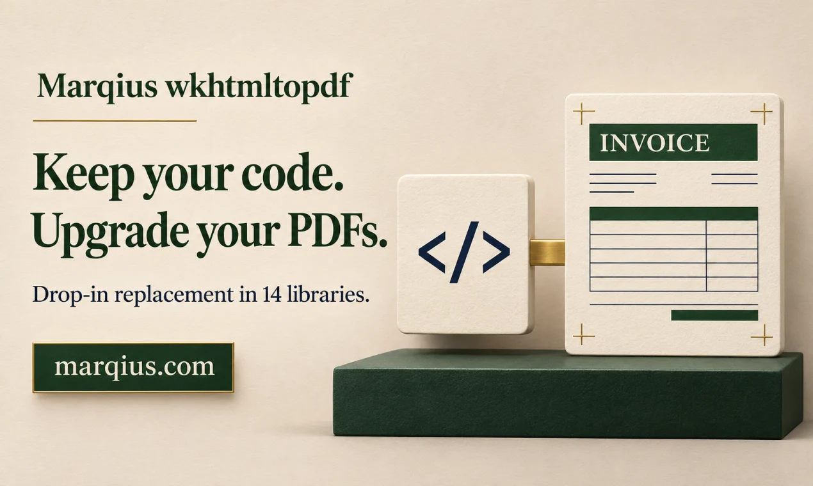

# Marqius wkhtmltopdf examples

[](https://github.com/marqius-wkhtmltopdf/marqius-wkhtmltopdf-examples/actions/workflows/render-examples.yml)



**Drop-in replacement for wkhtmltopdf in 14 libraries.**

Keep your library and templates. These small examples show the executable setting and render a sample invoice using Marqius. Start with the [switching guide](https://marqius.com/wkhtmltopdf/), or read the [developer manual](https://marqius.com/download/developer-manual.pdf).

## Install Marqius

```bash
curl -fsSL https://marqius.com/marqius-wkhtmltopdf.sh -o install-marqius.sh
# Review the installer, then run it. It verifies its executable download.
bash install-marqius.sh
```

The installer supplies a `wkhtmltopdf` executable. Keep your existing executable while evaluating; use the manual when you are ready to take over. Put the installed Marqius executable on PATH before running these examples. You can set `WKHTMLTOPDF_BINARY` to its absolute path (`export WKHTMLTOPDF_BINARY="$(command -v wkhtmltopdf)"`).

## Pick your library

| Library | Runtime | Detailed guide |
| --- | --- | --- |
| [python-pdfkit](examples/python-pdfkit/) | Python | [Chapter](https://marqius.com/download/developer-manual.pdf#page=7) |
| [django-wkhtmltopdf](examples/django-wkhtmltopdf/) | Python / Django | [Chapter](https://marqius.com/download/developer-manual.pdf#page=13) |
| [KnpLabs Snappy](examples/knplabs-snappy/) | PHP | [Chapter](https://marqius.com/download/developer-manual.pdf#page=16) |
| [laravel-snappy](examples/laravel-snappy/) | PHP / Laravel | [Chapter](https://marqius.com/download/developer-manual.pdf#page=18) |
| [phpwkhtmltopdf](examples/phpwkhtmltopdf/) | PHP | [Chapter](https://marqius.com/download/developer-manual.pdf#page=20) |
| [KnpSnappyBundle](examples/knp-snappy-bundle/) | PHP / Symfony | [Chapter](https://marqius.com/download/developer-manual.pdf#page=23) |
| [CakePdf](examples/cakepdf/) | PHP / CakePHP | [Chapter](https://marqius.com/download/developer-manual.pdf#page=26) |
| [wicked_pdf](examples/wicked-pdf/) | Ruby | [Chapter](https://marqius.com/download/developer-manual.pdf#page=29) |
| [PDFKit (Ruby)](examples/ruby-pdfkit/) | Ruby | [Chapter](https://marqius.com/download/developer-manual.pdf#page=31) |
| [wkhtmltopdf for Node](examples/node-wkhtmltopdf/) | Node.js | [Chapter](https://marqius.com/download/developer-manual.pdf#page=33) |
| [go-wkhtmltopdf](examples/go-wkhtmltopdf/) | Go | [Chapter](https://marqius.com/download/developer-manual.pdf#page=35) |
| [java-wkhtmltopdf-wrapper](examples/java-wkhtmltopdf-wrapper/) | Java | [Chapter](https://marqius.com/download/developer-manual.pdf#page=38) |
| [pdf_generator (Elixir)](examples/elixir-pdf-generator/) | Elixir | [Chapter](https://marqius.com/download/developer-manual.pdf#page=41) |
| [Rotativa.AspNetCore](examples/rotativa-aspnetcore/) | .NET | [Chapter](https://marqius.com/download/developer-manual.pdf#page=44) |

## Run a first example

```bash
cd examples/python-pdfkit
python3 -m venv .venv
. .venv/bin/activate
pip install -r requirements.txt
python render.py invoice.pdf
```

For PHP, run `composer install` in a standalone example folder, then `php render.php invoice.pdf`. Laravel and Symfony examples are copied into an existing application; see their individual READMEs and `scripts/run-php.sh` for fresh-project setup. For Node.js, run `npm install` then `node render.js invoice.pdf`. For Ruby, install the Gemfile with Bundler and run `bundle exec ruby render.rb invoice.pdf`. Go uses `go run . invoice.pdf`; Java uses Maven's `exec:java` with `Smoke` as the main class. Elixir uses `mix deps.get` then `mix run render.exs invoice.pdf`. The Rotativa example is an ASP.NET Core MVC application; its runner starts it on loopback only.

## How do I know the output matches?

Use the [developer manual's measured results](https://marqius.com/download/developer-manual.pdf#page=5) to assess library compatibility, then compare PDFs from your own templates. The table records the libraries' own suites on **19 November 2026**, using **wkhtmltopdf 0.12.6.1** on Debian 12 and the same environment with **Marqius 0.12.4**, then the fixes released in **0.12.5**. The baseline column shows passing tests out of the whole suite; the Marqius columns count those same baseline-passing tests that also passed after the switch.

| Library | wkhtmltopdf baseline | Also passing with Marqius 0.12.4 | Also passing with Marqius 0.12.5 |
|---|---|---|---|
| python-pdfkit | 47 / 47 | 47 | 47 |
| imgkit | 45 / 48 | 44 | 45 |
| django-wkhtmltopdf | 14 / 18 | 14 | 14 |
| KnpLabs Snappy | 49 / 49 | 49 | 49 |
| laravel-snappy | 9 / 9 | 9 | 9 |
| phpwkhtmltopdf | 34 / 34 | 34 | 34 |
| KnpSnappyBundle | 26 / 26 | 26 | 26 |
| CakePdf | 32 / 34 | 32 | 32 |
| wicked_pdf | 61 / 61 | 58 | 61 |
| PDFKit (Ruby) | 180 / 182 | 180 | 180 |
| wkhtmltopdf for Node | 5 / 5 | 5 | 5 |
| go-wkhtmltopdf | 34 / 35 | 34 | 34 |
| java-wkhtmltopdf-wrapper | 30 / 30 | 29 | 30 |
| pdf_generator (Elixir) | 12 / 15 | 12 | 12 |
| Rotativa.AspNetCore | 10 / 10 | 10 | 10 |

The manual includes **14 PDF libraries plus imgkit**, which produces images. KnpLabs Snappy, KnpSnappyBundle and CakePdf's own suites test wrapper code without executing the converter; each chapter also includes a real before/after rendering smoke test. These historical suite counts describe compatibility and do not certify pixel-identical output for every template. The current public workflow separately verifies the 14 runnable PDF examples.

**How commands were captured.** A recording shim in front of the executable logs each call and its arguments, then delegates to the installed converter. This records the command lines driven by the real library calls for the manual's chapters. It preserves the converter's execution and exit status. Tests that mock the converter remain wrapper-code tests.

**What a PDF comparison checks.** The manual's original smoke documents used unstyled HTML and produced an **appearance-only** verdict: the words and pages agreed, while the default font and some positions differed. Review fonts, wrapping, images, headers, footers and pagination on representative documents. The manual's [comparison method and known differences](https://marqius.com/download/developer-manual.pdf#page=6) explain the verdicts and the stricter appearance checks.

## Compare before switching

Render the same representative document with your current engine and Marqius. Compare fonts, wrapping, headers, footers and page breaks. Keep a rollback path until the result meets your production requirements. The examples use static sample HTML and do not configure a service for untrusted documents.

The [render-examples workflow](.github/workflows/render-examples.yml) exercises all 14 integrations on Linux and checks that each output is a PDF containing the expected invoice text. The badge above links to its current result and downloadable artifacts.

## Licence and plans

The example code in this repository is MIT licensed. The Marqius converter is proprietary software under its own [licence](https://marqius.com/wkhtmltopdf/licence-agreement/). This repository contains integration examples, not the converter's source or binaries.

[30-day no-card trial and wkhtmltopdf pricing](https://marqius.com/wkhtmltopdf-buy/): $10 USD per Client per month, or $500 USD per Client for a lifetime licence with upgrades; applicable taxes are additional. See the licence for the legal-entity definition of a Client.

[marqius.com](https://marqius.com/) · [All 14 integrations](https://marqius.com/wkhtmltopdf/) · [Download and install](https://marqius.com/wkhtmltopdf/download/)
